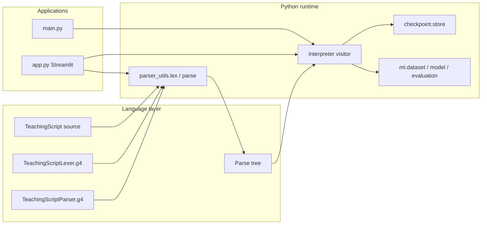

# TeachingScript: An ANTLR-Based Language for Machine-Learning Training and Evaluation

TeachingScript is a small domain-specific language (DSL) for describing
machine-learning workflows with readable commands instead of imperative Python.
Programs are lexed and parsed with **ANTLR 4.13.2**, executed by a Python
**visitor/interpreter**, and backed by a real **scikit-learn** pipeline on the
Iris dataset (extensible to any CSV matching the project contract).

**Version:** 1.0.0 (see `ui/theme.py`)

---

## Problem statement

Training and evaluating a classifier involves repetitive steps: load data, split,
train, evaluate, iterate with new examples, save and restore model state.
TeachingScript expresses these steps declaratively so the focus stays on
**language design, parsing, and interpretation** while still demonstrating
working ML behaviour.

## Objectives

- Define a concise grammar for ML teaching workflows.
- Generate a Python lexer/parser from ANTLR grammars.
- Execute programs via a parse-tree visitor (no regex “fake parser”).
- Load CSV datasets, train a `DecisionTreeClassifier`, evaluate on a **fixed** test split.
- Support `add_examples`, checkpoints, and rollback.
- Provide a CLI and a Streamlit IDE-style UI for demonstration.

## Implemented features

| Area | Status |
|------|--------|
| ANTLR lexer/parser grammars | Implemented |
| Generated Python parser + visitor base | Implemented |
| Syntax validation tests (`.tscript` + `.ts` examples) | Implemented |
| Interpreter for all six commands | Implemented |
| CSV dataset load + stratified split (seed 42) | Implemented |
| Model train / add_examples / snapshot / restore | Implemented |
| Accuracy + confusion matrix on held-out test set | Implemented |
| In-memory and on-disk checkpoints | Implemented |
| CLI (`main.py`) | Implemented |
| Streamlit UI (`app.py`) | Implemented |
| Automated pytest suite (36 tests) | Implemented |

Planned / out of scope for this mini-project: multiple lessons per file, richer
ML algorithms, cloud deployment, authentication.

---

## Technology stack

- **Python** 3.10+
- **ANTLR** 4.13.2 tool JAR + `antlr4-python3-runtime==4.13.2`
- **Java** 17+ (for parser generation only)
- **scikit-learn**, **pandas**, **numpy**
- **Streamlit** 1.30+ (UI)
- **matplotlib** (confusion-matrix heatmap in UI)
- **pytest**

---

## Prerequisites

- Windows 10/11 (instructions below use PowerShell)
- Python 3.10 or newer
- Java JDK 17+ on `PATH` (for `generate_parser.ps1`)
- `antlr-4.13.2-complete.jar` in the project root (not committed; download from
  [ANTLR](https://www.antlr.org/download.html) if missing)

---

## Project directory structure

```text
TeachAIx/
├── TeachingScriptLexer.g4      # Lexer grammar (source of truth)
├── TeachingScriptParser.g4     # Parser grammar
├── generate_parser.ps1         # Regenerate generated/
├── run_tests.ps1               # Regenerate parser + pytest
├── requirements.txt
├── main.py                     # CLI entry point
├── app.py                      # Streamlit UI entry point
├── generated/                  # ANTLR Python output (committed)
├── interpreter/
│   ├── parser_utils.py         # Lex/parse; only importer of generated/
│   └── visitor.py              # Interpreter (TeachingScript commands)
├── ml/
│   ├── dataset.py              # CSV load, validation, split
│   ├── model.py                # DecisionTreeClassifier wrapper
│   └── evaluation.py           # Accuracy + confusion matrix
├── checkpoint/
│   └── store.py                # Optional on-disk checkpoint files
├── ui/
│   ├── theme.py                # Dark theme + version
│   └── execution.py            # UI run pipeline with stage metadata
├── data/
│   └── iris.csv
├── examples/
│   ├── valid/                  # *.ts (runtime) + *.tscript (parser suite)
│   └── invalid/
├── docs/
│   ├── TOKENS.md
│   ├── DEMO.md
│   └── CHECKLIST.md
├── scripts/
│   └── make_iris.py
└── tests/
    ├── test_parser.py          # Standalone parser validation script
    ├── test_parser_smoke.py
    ├── test_interpreter.py
    ├── test_ml.py
    ├── test_checkpoint.py
    └── test_ui_smoke.py
```

---

## Installation (Windows PowerShell)

```powershell
Set-Location F:\TeachAIx
py -3.10 -m venv .venv
.\.venv\Scripts\Activate.ps1
python -m pip install --upgrade pip
python -m pip install -r requirements.txt
```

Place `antlr-4.13.2-complete.jar` in the project root if it is not already present.

### ANTLR version compatibility

- Tool: **4.13.2** (`antlr-4.13.2-complete.jar`)
- Python runtime: **`antlr4-python3-runtime==4.13.2`** (pinned in `requirements.txt`)

Regenerate after grammar changes:

```powershell
.\generate_parser.ps1
```

The script targets **Python3**, emits a **visitor** (`-visitor`), and **no listener**
(`-no-listener`). Expected outputs include `TeachingScriptLexer.py`,
`TeachingScriptParser.py`, and `TeachingScriptParserVisitor.py` under `generated/`.

---

## Architecture



1. **Lexer** — classifies character streams into tokens (keywords, strings, numbers, punctuation); skips whitespace and `#` comments.
2. **Parser** — builds a parse tree for `program → lesson → statements`.
3. **Visitor** — walks the tree and runs commands (load data, test, checkpoint, etc.).
4. **ML modules** — own dataset splitting and model state; the grammar does not embed ML logic.

---

## Grammar summary

Parser rules (see `TeachingScriptParser.g4`):

```text
program     : lesson EOF ;
lesson      : LESSON STRING LBRACE statement* RBRACE ;
statement   : datasetStmt | testStmt | checkpointStmt | rollbackStmt | addExamplesStmt ;
datasetStmt : DATASET STRING ;
testStmt    : TEST ;
checkpointStmt : CHECKPOINT STRING ;
rollbackStmt   : ROLLBACK STRING ;
addExamplesStmt : ADD_EXAMPLES LBRACE example* RBRACE ;
example     : featureVector ARROW STRING ;
featureVector : LBRACKET NUMBER (COMMA NUMBER)* RBRACKET ;
```

---

## Language command reference

| # | Command | Syntax | Semantics |
|---|---------|--------|-----------|
| 1 | **lesson** | `lesson "name" { ... }` | Entry point; runs nested statements in order. |
| 2 | **dataset** | `dataset "path.csv"` | Load CSV once; stratified 80/20 split (`random_state=42`); train model. Only one `dataset` per lesson. |
| 3 | **test** | `test` | Predict on fixed test split; log accuracy and confusion matrix. |
| 4 | **checkpoint** | `checkpoint "name"` | Serialize model + training rows (not test data) to memory and optionally disk. |
| 5 | **add_examples** | `add_examples { [f1,...,fn] -> "label" ... }` | Append labelled training rows; retrain; test set unchanged. |
| 6 | **rollback** | `rollback "name"` | Restore a prior checkpoint by name (memory or `--checkpoint-dir`). |

Line comments: `# comment until end of line`.

---

## Complete valid example

```text
lesson "iris_workflow" {
    dataset "data/iris.csv"

    test

    checkpoint "baseline"

    add_examples {
        [5.1, 3.5, 1.4, 0.2] -> "setosa"
        [6.0, 2.9, 4.5, 1.5] -> "versicolor"
    }

    test

    rollback "baseline"

    test
}
```

Also available as `examples/valid/01_iris_full.ts`.

---

## CLI usage

From the project root (so relative dataset paths resolve):

```powershell
.\.venv\Scripts\Activate.ps1
python main.py examples\valid\01_iris_full.ts
python main.py examples\valid\01_iris_full.ts --checkpoint-dir .\checkpoints
python main.py examples\valid\01_iris_full.ts --quiet
```

Exit codes: `0` success, `1` syntax/runtime error, `2` missing file.

Example output shape (values are **computed**, not hardcoded):

```text
[LESSON      ] lesson 'iris_workflow'
[DATASET     ] loaded 'data/iris.csv' (120 train / 30 test / 3 classes)
[TEST        ] accuracy = 0.9333 (28/30 correct)
                true \ pred      setosa  versicolor   virginica
                     ...
[CHECKPOINT  ] saved checkpoint 'baseline'
...
Completed successfully.
```

---

## Streamlit UI

```powershell
.\.venv\Scripts\Activate.ps1
streamlit run app.py
```

### UI features

- **Dark developer-tool theme** (`ui/theme.py`)
- **Workspace** — script editor, Run / Reset / Clear, optional disk checkpoints
- **Execution pipeline** — stages derived from real lex/parse/interpreter events
- **Evaluation tab** — accuracy metrics, matplotlib confusion matrix
- **Checkpoints tab** — save/restore log from the session
- **Examples** — load valid/invalid samples into the editor
- **Reference** — quick command summary

Runs are triggered only by **Run program** (not on every rerun).

---

## Testing

```powershell
.\run_tests.ps1
```

Or without regenerating the parser:

```powershell
python -m pytest -v
python tests\test_parser.py
```

The suite includes parser smoke tests, interpreter end-to-end runs, ML unit tests,
checkpoint persistence, and UI compile/smoke checks.

---

## Checkpoint and rollback behaviour

- **In-memory:** checkpoint blobs live in the `Session` for the current run.
- **On disk:** `--checkpoint-dir` (CLI) or the UI checkbox writes sanitised
  `*.pkl` wrappers via `checkpoint.store.CheckpointStore`.
- **Rollback** restores training arrays and the fitted classifier; the **test set
  never changes** after the initial `dataset` command.
- Snapshots use **pickle** for local trusted storage only — do not load arbitrary
  pickle files from untrusted sources.

---

## Troubleshooting

| Issue | Action |
|-------|--------|
| `antlr-4.13.2-complete.jar` missing | Download ANTLR 4.13.2 complete JAR into project root |
| `Could not import generated lexer/parser` | Run `.\generate_parser.ps1` |
| `Dataset file not found` | Run CLI/UI from project root; check path in `dataset "..."` |
| `unknown label` in `add_examples` | Label strings must match CSV class names exactly |
| `expected N features` | Feature vector length must match CSV feature columns |
| Java not found | Install JDK 17+ and ensure `java` is on PATH |

---

## Limitations

- One `lesson` per program; one `dataset` per lesson.
- CSV contract: numeric feature columns + single label column (last column).
- Classifier: `DecisionTreeClassifier` only (`random_state=42`).
- Accuracy may not improve after `add_examples` (depends on data and tree splits).
- Streamlit visual layout was verified via compile/smoke tests; interactive browser
  testing is recommended before a live demo.

---

## Security and local files

- Dataset paths are read from user scripts — use trusted CSV files only.
- Checkpoint directory names are sanitised to reduce path traversal risk.
- No network services or authentication in this project.

---

## Future enhancements

- Additional model types and hyperparameters in the DSL
- Multiple lessons or modules per file
- Richer type checking (vector length at parse time)
- CI workflow for parser regeneration and tests

---

## Academic contribution

The primary contribution is the **TeachingScript language**: grammar design,
ANTLR-generated lexer/parser, parse-tree structure, and a **visitor-based
interpreter** that maps language constructs to ML operations. The scikit-learn
model demonstrates that the DSL executes real workflows rather than mock output.

---

## License

See [LICENSE](LICENSE) in the repository.
